# VaultLedger

A personal finance ledger that runs on your own computer. You write entries the way you'd say them, and it keeps the books: categories, budgets, recurring bills, forecasts and foreign currency, all stored in a local SQLite file that never leaves your machine.


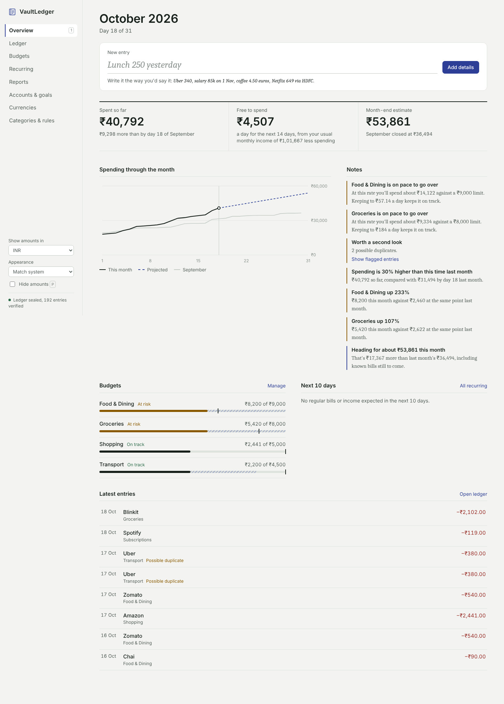

**What makes it different**

- **Plain-English entries.** Type `Lunch 250 yesterday` or `salary 85k on 1 Nov` and press Enter.
- **Categories that learn** from how you filed similar entries before.
- **Forecasts** for month-end spending, a free-to-spend figure per day, and warnings when a budget is on pace to go over.
- **Recurring detection** that finds rent, subscriptions, bills and salary in your history.
- **Monthly notes** in plain sentences about what changed.
- **A sealed ledger.** Each entry is chained to the previous one with SHA-256, so edits made outside the app are detected.
- **Six currencies** (INR, USD, EUR, GBP, CAD, JPY) with gain and loss tracking on money held in other currencies.

Everything runs offline. There is no account, no cloud sync and no external AI service.

> The screenshots below use sample data.

---

## A tour of the app

### Overview


The Overview is the current month at a glance, laid out like a bank statement.

- **New entry** at the top is where you add money in or out (see the next section).
- **Spent so far** compares this month with the same day of last month.
- **Free to spend** is how much you can spend per day for the rest of the month. It is your income (or your usual monthly income, if this month's hasn't arrived yet) minus what you've spent and the bills still due, split across the days left.
- **Month-end estimate** projects where spending will finish, from your everyday pace plus known bills that haven't been paid yet.
- **Spending through the month** draws this month's running total (solid line) against last month's (grey) and the projection (dashed). Hover over the chart to read any day.
- **Notes** are short observations about the month: budgets at risk or over, bills due soon, categories up or down compared with the same point last month, possible duplicate charges, and how much of your income you've kept.
- **Budgets** shows each limit as a bar. The hatched part is where you're projected to end up and the tick is the limit.
- **Next 10 days** lists recurring bills and income expected soon, even across the end of the month.
- **Latest entries** shows the most recent activity. Click any row to edit it.

### Writing an entry

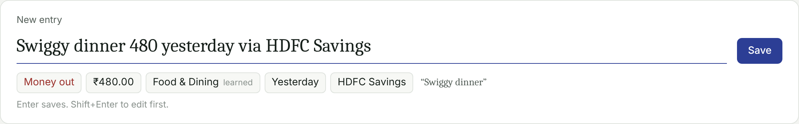

Type an entry the way you'd say it. As you type, VaultLedger shows how it read it: direction, amount, category, date and account. Press **Enter** to save, or **Shift+Enter** to open the full form first. After saving, an **Undo** link appears for a few seconds.

It understands:

| You type | It reads |
|---|---|
| `Uber 340` | ₹340, Transport, today |
| `Lunch 250 yesterday` | ₹250, Food & Dining, yesterday |
| `salary 85k on 1 Nov` | ₹85,000 money in, Salary, 1 November |
| `coffee 4.50 euros` | €4.50, Food & Dining |
| `paid $12 for spotify last monday` | $12, Subscriptions, last Monday |
| `Groceries at dmart 1,850 rs 26/10` | ₹1,850, Groceries, 26 October |
| `got 2 lakh bonus` | ₹2,00,000 money in, Salary |
| `Netflix 649 via HDFC Savings` | ₹649, Subscriptions, booked to the HDFC Savings account |

Amounts can use `k`, `lakh` and `crore`; dates can be `today`, `yesterday`, `3 days ago`, a weekday, `12 oct`, `12/10` (day first) or `2026-10-12`. The small *learned* or *rule* label next to the category shows where the suggestion came from. Click the category to cycle through alternatives, or the direction to switch between money in and money out.

### Ledger

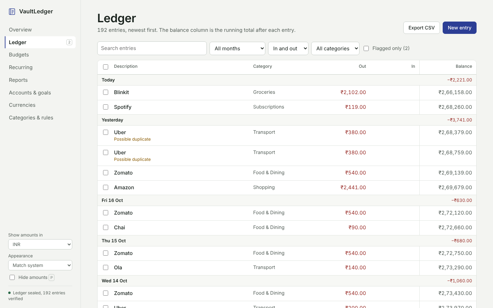

Every entry, newest first, grouped by day with each day's net total. Money out and money in have their own columns, and **Balance** is the running total after each entry, as in a paper ledger. Entries in another currency show the original amount under the converted one.

- Search with the box or press **/**. Filter by month, direction or category, or show **Flagged only** to review possible duplicates and unusually large expenses. Mark one as fine and it won't be flagged again.
- Tick rows to **move** them to another category or **delete** them in one go. Only the rows you can see are ever selected.
- **Export CSV** downloads everything, including each entry's SHA-256 hash.

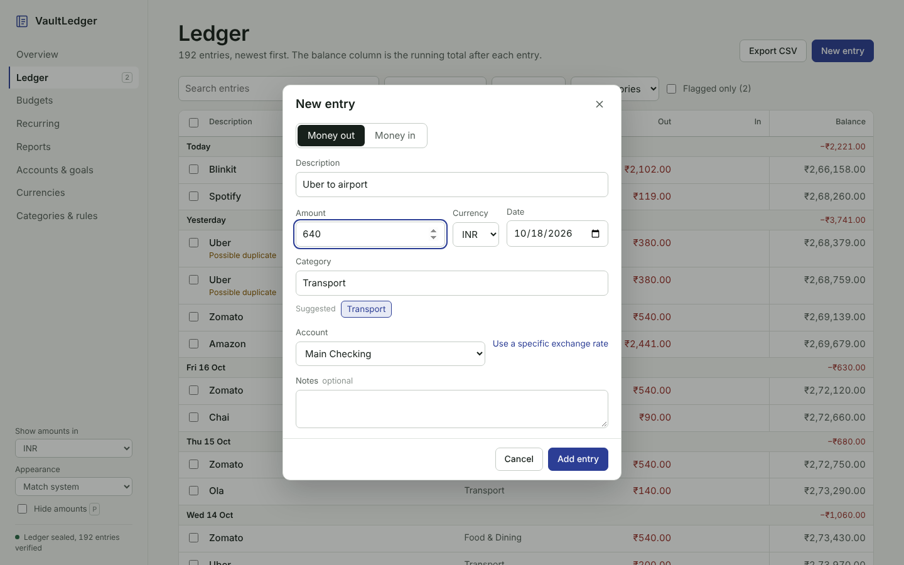

Click an entry, or **New entry**, to open the full form. As you type a description, it suggests categories from your history. You can set the account, a specific exchange rate and notes here.

### Budgets

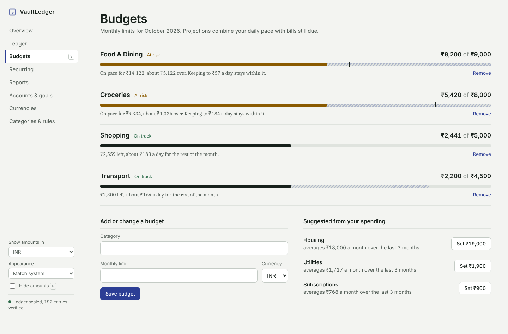

Monthly limits per category, in any currency. Each budget shows what you've spent, a bar with the projected month-end amount, and one sentence about what to do: how much is left per day, how far over you're heading, or how much you're already over.

**Suggested from your spending** proposes limits for categories without a budget, based on your average over the last three complete months. One click sets them.

### Recurring

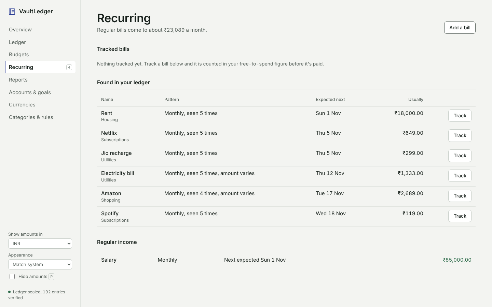

VaultLedger looks for entries with the same name, a steady schedule (weekly, monthly, quarterly or yearly) and a similar amount. Those appear under **Found in your ledger** with the next expected date.

**Track** one and it moves to **Tracked bills**, where it counts against your free-to-spend figure before it's paid. You can also **Add a bill** by hand. **Regular income** such as salary is detected the same way, and the Overview warns you if it's late.

### Reports

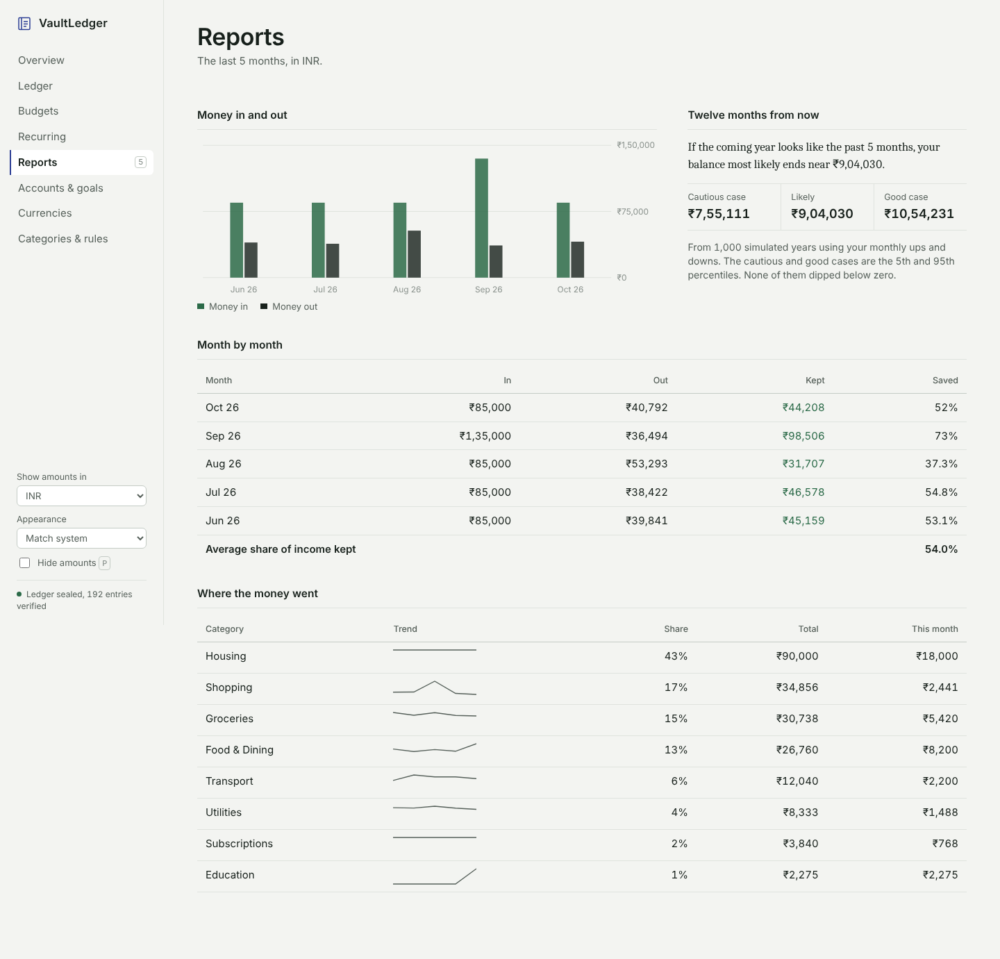

- **Money in and out** for each of the last twelve months.
- **Twelve months from now** runs 1,000 simulated years from your own monthly ups and downs, and gives a likely balance with a cautious and a good case (the 5th and 95th percentiles), plus how often the balance dipped below zero.
- **Month by month** shows income, spending, what you kept and the share of income saved.
- **Where the money went** ranks categories with a small trend line, their share of spending and this month's amount.

### Accounts & goals

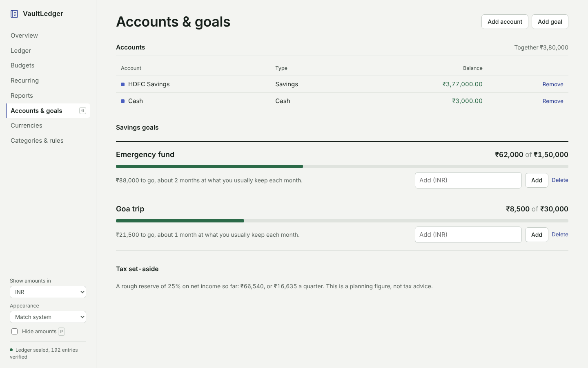

- **Accounts** hold an opening balance plus every entry booked to them, so each bank account, card or cash wallet has its own balance. Book an entry to an account from the form, or by writing the account's name in the entry line, for example `via HDFC Savings`.
- **Savings goals** show progress and estimate how many months are left at the rate you usually save. Add money to a goal right from its row.
- **Tax set-aside** is a rough 25% reserve on net income, for planning only.

### Currencies

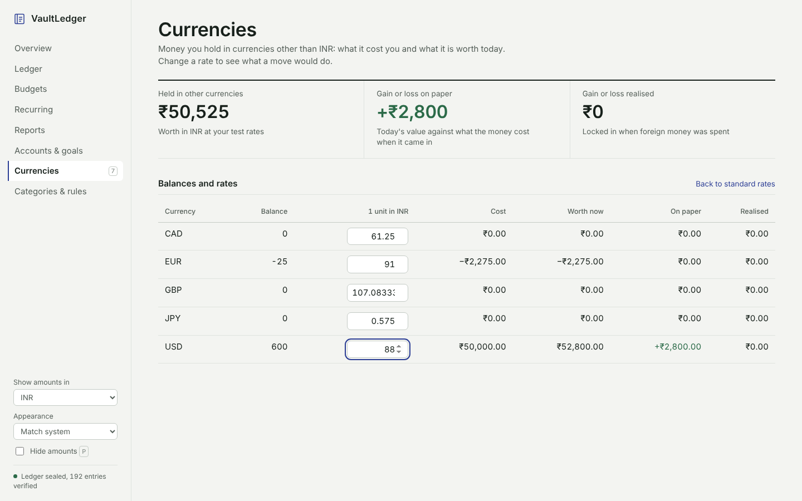

Money you hold in currencies other than the one you've chosen to show amounts in. For each currency you see the balance, what it cost when it came in, what it's worth now, the gain or loss on paper, and the gain or loss already realised when you spent it. Cost is tracked with a weighted average, so mixed rates are handled correctly.

Change any rate to see what a currency move would do; **Back to standard rates** resets it.

### Categories & rules

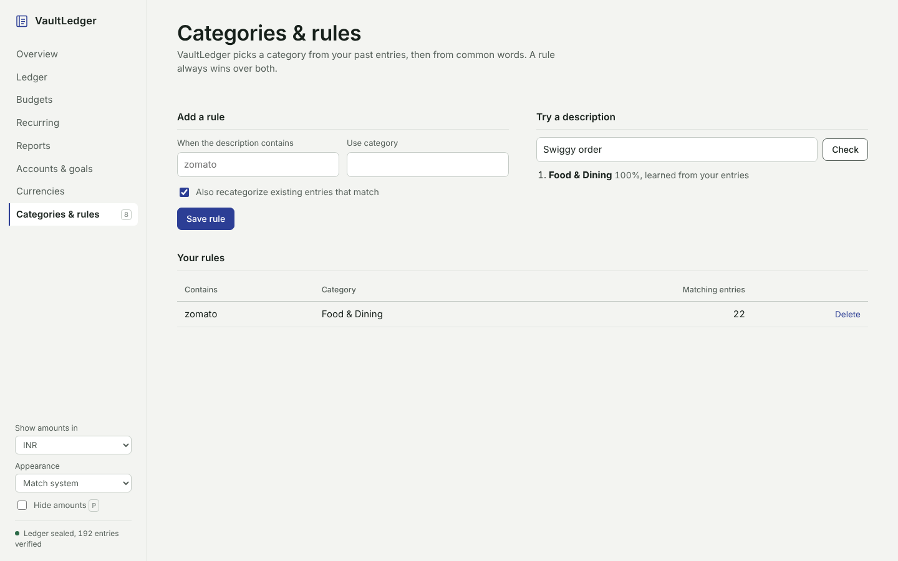

Categories are picked in this order: a **rule** you've written, then **your history** (entries with the same or similar description), then **common words** (a built-in list of Indian merchants and terms such as Swiggy, Zomato, Uber, Blinkit, Jio, rent and salary).

Add a rule when a shop keeps landing in the wrong place, and optionally re-file past entries that match. **Try a description** shows what would be picked and why.

### Dark mode and small screens

| Dark | Phone |
|---|---|
| 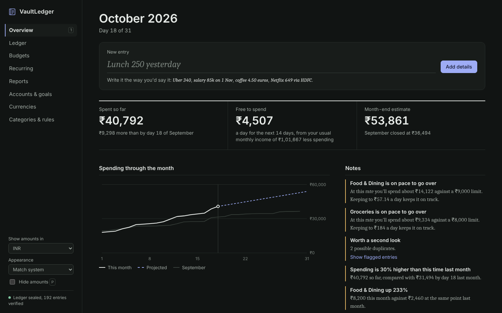 | 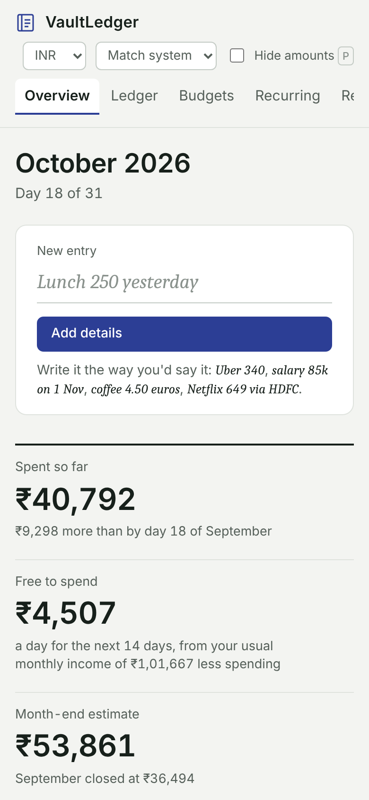 |

The appearance follows your system setting, or you can choose light or dark in the sidebar. The layout works down to phone width. **Hide amounts** (or press **P**) blurs every figure for when someone is looking over your shoulder.

---

## Getting started

### On Windows

1. Install [Python 3.10 or newer](https://www.python.org/downloads/) and tick *Add Python to PATH*.
2. Double-click **`Start-FinanceTracker.bat`**. It installs Flask if needed, starts the app and opens http://127.0.0.1:5000. Press any key in its window to stop it.

`Start-FinanceTracker.vbs` does the same without a console window, and `CreateDesktopShortcut.bat` puts a shortcut to it on your desktop.

### From source

```bash
git clone https://github.com/pranjaltripathi684-wq/VaultLedger.git
cd VaultLedger
pip install -r requirements.txt
python app.py
```

Then open http://127.0.0.1:5000. The database (`finance.db`) is created next to `app.py` on first run.

| Setting (environment variable) | Default | Purpose |
|---|---|---|
| `VAULTLEDGER_PORT` | `5000` | Port to serve on |
| `VAULTLEDGER_DB` | `finance.db` next to the app | Path to the database file |
| `VAULTLEDGER_DEBUG` | off | Set to `1` for Flask debug mode (development only) |
| `VAULTLEDGER_SECRET_KEY` | random per run | Session key for the older `/legacy` pages |

### Changing the interface

The built interface is included in `frontend/dist`, so Node is only needed if you change it:

```bash
cd frontend
npm install
npm run dev     # live-reloading dev server on :5173, talks to the Flask app on :5000
npm run build   # writes frontend/dist, which Flask serves
```

### Building a standalone .exe

```bash
pip install pyinstaller
pyinstaller FinanceTracker.spec
```

This produces `dist/VaultLedger.exe`. It keeps its `finance.db` next to the exe.

---

## Keyboard shortcuts

| Key | Action |
|---|---|
| `N` | Write a new entry (Overview) |
| `/` | Search the ledger |
| `1` to `8` | Switch sections |
| `P` | Hide or show amounts |
| `Enter` / `Shift+Enter` | Save the entry / open the full form first |
| `Esc` | Close a dialog or clear the entry line |

---

## How it works

| Part | Where | What it does |
|---|---|---|
| Entry parser | `intelligence.py` → `parse_entry` | Finds the amount, currency, date, account and direction in free text, and the title from what's left |
| Categorizer | `intelligence.py` → `suggest_category` | Scores categories from your rules, entries with the same description, shared words and a seed vocabulary |
| Recurring detection | `intelligence.py` → `detect_recurring` | Groups entries by normalized name, checks the gaps between dates match a cadence and the amounts are similar, predicts the next date |
| Forecast | `intelligence.py` → `build_forecast` | Everyday spending pace (smoothed early in the month with last month's) + bills still due = month-end estimate, budget pacing and free to spend |
| Notes | `intelligence.py` → `build_insights` | Ranks observations by importance and writes them as sentences |
| Ledger seal | `app.py` → `compute_row_hash` | SHA-256 over each entry plus the previous entry's hash; verified on every load |
| Duplicates and outliers | `app.py` → `detect_anomalies` | Same description, amount, currency and direction within two days (habitual purchases only on the same day), and expenses 2 standard deviations above their category's average |
| FX gains | `app.py` → `calculate_fx_holdings_and_gains` | Weighted-average cost per currency, marked to the current rate |

All amounts are stored in the currency they happened in, with the exchange rate at the time, and converted for display.

### Project structure

```text
VaultLedger/
├── app.py                     Flask server: REST API, ledger seal, anomaly detection, FX engine
├── intelligence.py            Entry parser, categorizer, recurring detection, forecasts, notes
├── db.py                      SQLite connection and setup
├── schema.sql                 Database tables
├── requirements.txt
├── Start-FinanceTracker.bat   Windows launcher
├── Start-FinanceTracker.vbs   Windows launcher without a console window
├── CreateDesktopShortcut.bat  Puts a launcher shortcut on the desktop
├── FinanceTracker.spec        PyInstaller recipe for the .exe
├── frontend/                  React interface (Vite)
│   ├── src/App.jsx            Shell, navigation, settings
│   ├── src/entry.jsx          Entry line and entry form
│   ├── src/pages/             One file per page
│   └── dist/                  Built interface served by Flask
├── templates/, static/        The older server-rendered interface, still at /legacy
└── docs/screenshots/          Images used in this README
```

---

## Privacy

Your data lives in `finance.db` on your own computer. The app listens only on `127.0.0.1` and the main interface makes no outside network requests (the older `/legacy` pages load the Chart.js library from a CDN). `.gitignore` keeps the database out of version control.

## License

MIT
